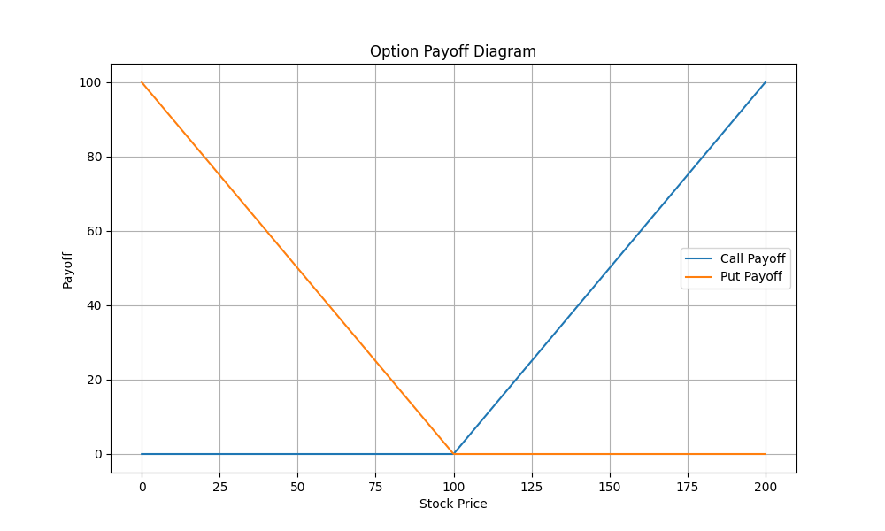
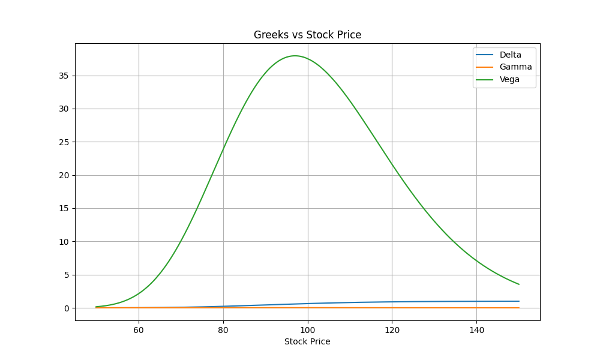
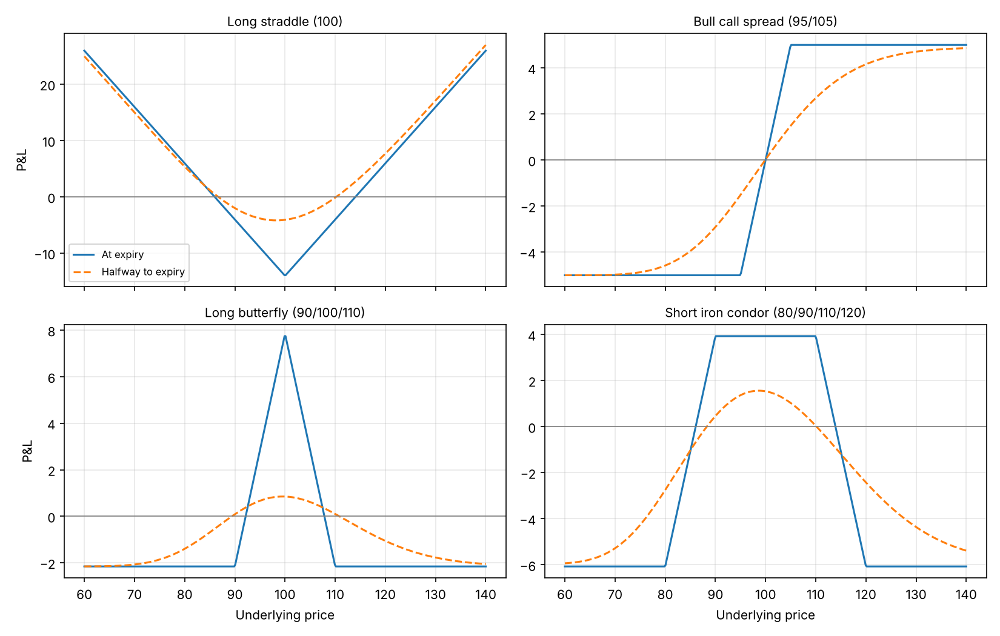
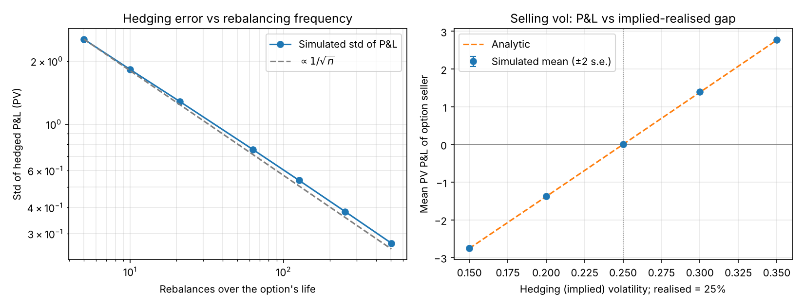

# Options Payoff & Greeks Modeling (Black–Scholes)

This project models **European option payoffs** and **Black–Scholes Greeks** to show how option value and risk sensitivities change with the underlying price.

It’s designed as a compact, recruiter-friendly reference for:

- Payoff diagrams (call/put)
- Analytical Greeks under Black–Scholes (Delta, Gamma, Vega, Theta, Rho)
- Visual intuition: how risk changes across moneyness

---

## Model

Under Black–Scholes, the underlying follows Geometric Brownian Motion:

$$
dS_t = r S_t dt + \sigma S_t dW_t
$$

European option prices are computed using the closed-form Black–Scholes formula, and Greeks are computed analytically.

---

## Payoff Diagram

Call and put payoffs at expiration:

- Call payoff: max($S_T - K$, 0)
- Put payoff:  max($K - S_T$, 0)



---

## Greeks vs Underlying Price

The following plot shows how **Delta, Gamma, and Vega** vary as a function of the underlying price $S$.

Key intuition:

- **Delta** increases from ~0 to ~1 as the call moves from OTM → ITM  
- **Gamma** peaks near ATM and falls off in the tails  
- **Vega** is typically highest near ATM (longer-dated options increase Vega)



---

## Implied Volatility

`src/implied_vol.py` inverts Black–Scholes. Given a market price, it finds $\sigma$ such that

$$
C_{BS}(S, K, T, r, \sigma) = C_{\text{market}}
$$

It uses **safeguarded Newton–Raphson**:

- Newton steps use vega and converge quadratically near the root.
- Every iteration also narrows a $[\sigma_{low}, \sigma_{high}]$ bracket. Price is increasing in $\sigma$, so each evaluation tells you which side of the root you're on.
- Any Newton step that would leave the bracket, or a near-zero vega, falls back to bisection. Plain Newton can diverge for deep in- or out-of-the-money options; this can't.
- It starts from the Brenner–Subrahmanyam approximation, $\sigma_0 \approx \sqrt{2\pi/T}\,C/S$.
- Prices outside the no-arbitrage bounds are rejected, as are prices with no time value, where no unique $\sigma$ exists.

Round trip: price a call at $\sigma = 25\%$ ($S = 100$, $T = 0.5$, $r = 4\%$), then solve back:

| Strike | Price at σ = 25% | Solved σ |
|---|---|---|
| 80 | 22.1882 | 0.25000000 |
| 90 | 14.1127 | 0.25000000 |
| 100 | 8.0080 | 0.25000000 |
| 110 | 4.0599 | 0.25000000 |
| 120 | 1.8575 | 0.25000000 |

```python
from src.implied_vol import implied_volatility

implied_volatility(8.0080, S=100, K=100, T=0.5, r=0.04)  # 0.2500001 (the input price is rounded to 4 dp)
```

---

## Multi-Leg Strategies

`src/strategies.py` prices and analyses option combinations built from signed `Leg(option_type, strike, quantity)` objects. For a strategy $\{(q_i, K_i, \text{type}_i)\}$:

$$
\text{Value} = \sum_i q_i\,V_i(S,K_i,T,r,\sigma), \qquad
\text{Payoff}(S_T)=\sum_i q_i\,\text{intrinsic}_i(S_T), \qquad
\text{P\&L}(S_T)=\text{Payoff}(S_T)-\text{Value}(S_0)
$$

Position Greeks are the quantity-weighted sums of leg Greeks (each checked against finite differences of the strategy value). Because expiry P&L is piecewise linear with kinks only at the strikes, break-evens are found exactly by interpolation, and the maximum profit and loss come from the strike grid plus the net call quantity (which fixes the slope above the top strike).

Built-ins: `long_straddle`, `long_strangle`, `bull_call_spread`, `bear_put_spread`, `butterfly`, `iron_condor`.

Parameters: $S_0=100$, $T=0.5$, $r=4\%$, $\sigma=25\%$.

| Strategy | Net premium | Break-evens | Max profit | Max loss |
|---|---|---|---|---|
| Long straddle (100) | 14.04 | 85.96, 114.04 | unbounded | 14.04 |
| Bull call spread (95/105) | 5.01 | 100.01 | 4.99 | 5.01 |
| Long butterfly (90/100/110) | 2.16 | 92.16, 107.84 | 7.84 | 2.16 |
| Short iron condor (80/90/110/120) | -3.93 (credit) | 86.07, 113.93 | 3.93 | 6.07 |



```python
from src import strategies as st

legs = st.iron_condor(80, 90, 110, 120)
st.break_evens(legs, S0=100, T=0.5, r=0.04, sigma=0.25)   # [86.07, 113.93]
st.greeks(legs, S=100, T=0.5, r=0.04, sigma=0.25)["vega"]
```

Regenerate the table and figure with `python -m src.strategy_plots`.

---

## Delta-Hedging Simulation

`src/delta_hedge.py` simulates the seller of a European option who collects the Black–Scholes premium, holds $\Delta$ shares, finances at $r$ and rebalances at $n$ equally spaced dates while the stock follows GBM with volatility $\sigma_{real}$. Each path's terminal wealth is discounted back to a present-value P&L.

Two results are reproduced and tested:

- **Hedging error shrinks like $1/\sqrt{n}$.** With $\sigma_{hedge}=\sigma_{real}$, the continuous-hedge limit has zero error; with $n$ rebalances the P&L standard deviation scales as $n^{-1/2}$ (the last column is roughly constant).
- **Vol mismatch drives expected P&L.** If you hedge (and sell) at $\sigma_{hedge}$ but the stock realises $\sigma_{real}$, the seller's expected present-value P&L is

$$
\mathbb{E}\left[\text{P\&L}\right] = \tfrac12\left(\sigma_{hedge}^2-\sigma_{real}^2\right)\int_0^T e^{-rt}\,\mathbb{E}\!\left[S_t^2\,\Gamma_t\right]dt,
$$

which `expected_vol_mismatch_pnl` evaluates numerically. Selling rich implied vol earns money on average; selling cheap vol loses it.

Setup: ATM call, $S_0=K=100$, $T=0.5$, $r=4\%$, $\sigma_{real}=25\%$, 20,000 paths, seed 0.

| Rebalances | Std of P&L | Std × √n |
|---|---|---|
| 5 | 2.544 | 5.688 |
| 10 | 1.824 | 5.767 |
| 21 | 1.285 | 5.888 |
| 63 | 0.757 | 6.009 |
| 126 | 0.539 | 6.052 |
| 252 | 0.382 | 6.067 |
| 504 | 0.270 | 6.062 |

Mean P&L when selling at a hedging (implied) vol different from the 25% realised, 126 rebalances:

| Hedge vol | Simulated mean | Std. error | Analytic |
|---|---|---|---|
| 15% | -2.752 | 0.010 | -2.756 |
| 20% | -1.377 | 0.006 | -1.381 |
| 25% | +0.006 | 0.004 | +0.000 |
| 30% | +1.391 | 0.005 | +1.382 |
| 35% | +2.775 | 0.007 | +2.764 |



```python
from src.delta_hedge import simulate_delta_hedge

res = simulate_delta_hedge(S0=100, K=100, T=0.5, r=0.04, sigma_real=0.25,
                           sigma_hedge=0.35, n_steps=126)
res.mean, res.stderr   # about +2.77, 0.007 
```

Regenerate the tables and figure with `python -m src.hedge_study`.

---

## Tests

```bash
pip install -r requirements.txt pytest
pytest -q
```

173 tests cover:

- Reference prices from Hull and put–call parity.
- Every Greek checked against a finite-difference estimate.
- Implied volatility round trips across 120 combinations of strike, maturity and volatility, for calls and puts.
- Error handling at the no-arbitrage bounds.
- Multi-leg strategies: payoffs, additivity of value, convergence to payoff at expiry, position Greeks vs finite differences, break-evens and max profit/loss.
- Delta hedging: zero mean error at matched vol, $n^{-1/2}$ error scaling, and simulated vs analytic expected P&L under vol mismatch (calls and puts).

CI runs the suite on Python 3.11, 3.12 and 3.13.

---

## How to Run

From the repo root:

```bash
python -m venv .venv
.\.venv\Scripts\activate
pip install -r requirements.txt
python -m src.visualize
