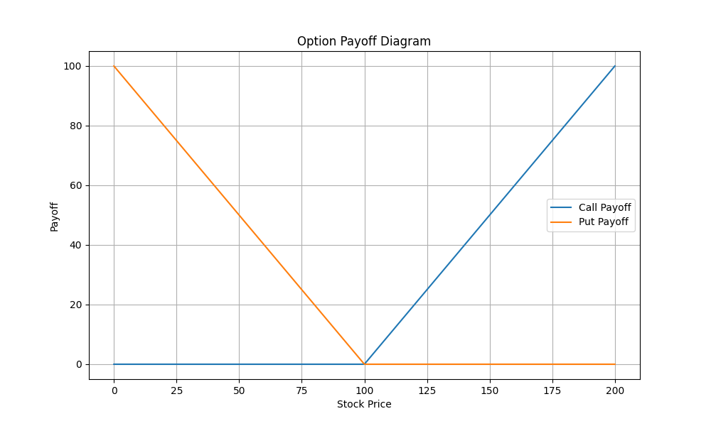
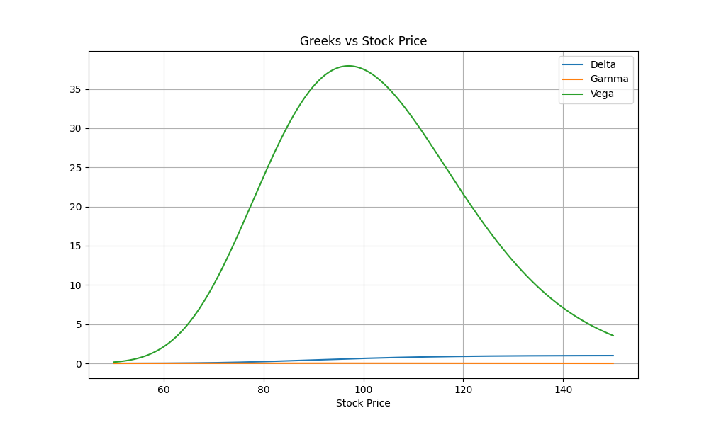

# Options Payoff & Greeks Modeling (Black–Scholes)

This project models **European option payoffs** and **Black–Scholes Greeks** to show how option value and risk sensitivities change with the underlying price.

It’s designed as a compact, recruiter-friendly reference for:

- Payoff diagrams (call/put)
- Analytical Greeks under Black–Scholes (Delta, Gamma, Vega, Theta, Rho)
- Visual intuition: how risk changes across moneyness

---

## Model

Under Black–Scholes, the underlying follows Geometric Brownian Motion:

$$
dS_t = r S_t dt + \sigma S_t dW_t
$$

European option prices are computed using the closed-form Black–Scholes formula, and Greeks are computed analytically.

---

## Payoff Diagram

Call and put payoffs at expiration:

- Call payoff: max($S_T - K$, 0)
- Put payoff:  max($K - S_T$, 0)



---

## Greeks vs Underlying Price

The following plot shows how **Delta, Gamma, and Vega** vary as a function of the underlying price $S$.

Key intuition:

- **Delta** increases from ~0 to ~1 as the call moves from OTM → ITM  
- **Gamma** peaks near ATM and falls off in the tails  
- **Vega** is typically highest near ATM (longer-dated options increase Vega)



---

## How to Run

From the repo root:

```bash
python -m venv .venv
.\.venv\Scripts\activate
pip install -r requirements.txt
python -m src.visualize
