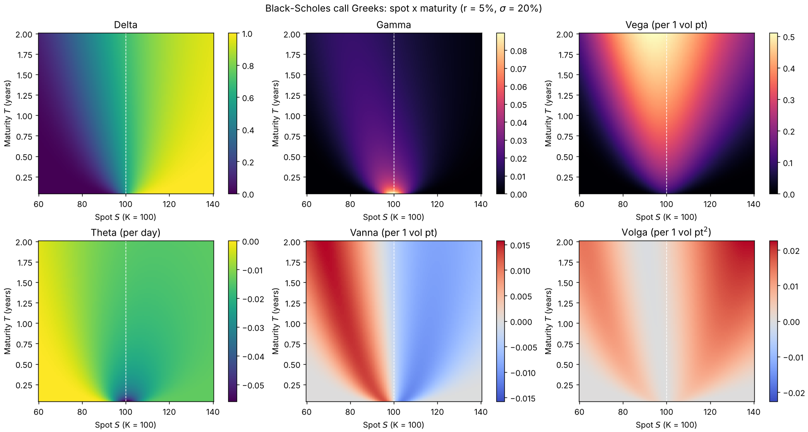

# Greeks surfaces

`src/greeks_surface.py` evaluates Black–Scholes Greeks on whole grids in one vectorised call
(spot × maturity, or strike × maturity) and adds two second-order Greeks that the base module
lacks.

```python
import numpy as np
from src.greeks_surface import greek_grid

spots = np.linspace(60, 140, 161)
mats = np.linspace(0.05, 2.0, 120)
vega_surface = greek_grid("vega", spots, mats, K=100, r=0.05, sigma=0.20)  # shape (120, 161)
```

Reproduce the figure and table: `python -m src.greeks_surface`.

## Definitions

With $d_1, d_2$ as usual and $\varphi$ the standard normal density:

$$
\text{vanna}=\frac{\partial^2 V}{\partial S\,\partial\sigma}=-\frac{\varphi(d_1)\,d_2}{\sigma},
\qquad
\text{volga}=\frac{\partial^2 V}{\partial\sigma^2}=\mathcal{V}\,\frac{d_1 d_2}{\sigma}
$$

where $\mathcal{V}=S\varphi(d_1)\sqrt{T}$ is vega. Put theta follows from put–call parity,
$\Theta_{put}=\Theta_{call}+rKe^{-rT}$. Tests check vanna, volga and put theta against
finite differences, put–call parity of delta on the grid, and that gamma, vega, vanna and volga
are identical for calls and puts.

## Spot × maturity heatmaps

Call, $K=100$, $r=5\%$, $\sigma=20\%$:



What the surfaces show:

- **Gamma** concentrates at-the-money and short-dated; it is the dominant risk in the last weeks.
- **Vega** is largest ATM and grows with maturity (it scales with $\sqrt{T}$), the opposite
  shape to gamma.
- **Theta** is most negative ATM at short maturity, where time value decays fastest.
- **Vanna** changes sign around the at-the-money line ($d_2=0$): it is positive for OTM calls
  (lower spot) and negative for ITM ones, so a vol move shifts delta in opposite directions on
  either side of the strike.
- **Volga** is near zero ATM and rises in the wings, i.e. wing options are convex in volatility.

## ATM call Greeks ($S=K=100$)

Output of `python -m src.greeks_surface` (per unit, not per vol point or per day):

| Greek | T=0.1 | T=0.5 | T=1.0 |
|---|---|---|---|
| delta | 0.54406 | 0.59773 | 0.63683 |
| gamma | 0.06269 | 0.02736 | 0.01876 |
| vega | 12.53863 | 27.35866 | 37.52403 |
| theta | -15.12027 | -8.11597 | -6.41403 |
| vanna | -0.09404 | -0.20519 | -0.28143 |
| volga | 0.32914 | 3.59082 | 9.85006 |
